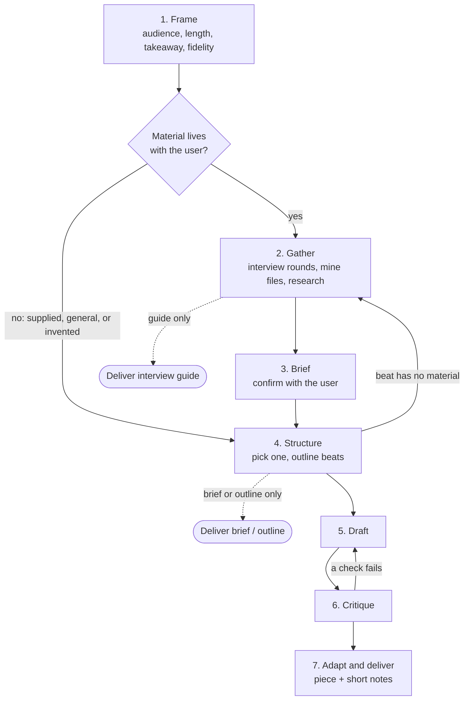

# bard

<p align="center">
  
</p>

An [Agent Skill](https://agentskills.io/home) that makes an agent act as a bard: it gathers a story's raw material, then shapes it with well-known storytelling structures so the audience stays captivated and learns something.

The skill itself lives in [`skills/bard/`](skills/bard/). Its workflow:

1. **Frame**: audience, occasion, length, one-sentence takeaway, and fidelity (documentary, dramatized, or invented).
2. **Gather**: interview the user in rounds, mine repos and files, research, and prepare interview guides for other stakeholders. Every fact goes in a source ledger.
3. **Brief**: a one-page story brief, confirmed with the user before drafting when there was an interview.
4. **Structure**: pick one structure by genre, then by purpose (SCQA, Sparkline, Customer-as-hero, Mystery, Kishōtenketsu, Story Spine, Three-act, Story Circle, Hero's Journey), compressed to ABT form for short pieces.
5. **Draft** to the target format (talk script, case study, and so on), 6. **Critique** against a checklist, 7. **Adapt** into extra formats or a length ladder and deliver with short notes.

It can stop early and deliver just a story brief or outline, or just an interview guide for someone else.



For fun, the bard's voice is opt-in medieval, measured in tankards of mead: from 0 (sober scribe) up to "the whole barrel" (rhyming recaps and toasts to you). It flavors only the bard's chat, never the story, and facts stay exact. Say "bard, two tankards" or "sober up" any time.

It covers technical, business, educational, and creative/personal stories.

## Usage

Ask an agent for a story, e.g. "help me turn our database migration into a 5-minute talk" or "write a short story that teaches new hires how DNS works".

## Install

**With the `npx skills` installer** (supports [79 agents](https://github.com/vercel-labs/skills/blob/main/docs/agents.md)):

```bash
npx skills add colchuck-ai/bard -g -a claude-code       # or -a cursor, codex, gemini-cli, ...
npx skills add https://github.com/colchuck-ai/bard/tree/v0.1.0/skills/bard -g   # pin a release
```

**With `install.sh`** (no Node needed). It installs the latest release, checksum-verified:

```bash
curl -fsSL https://raw.githubusercontent.com/colchuck-ai/bard/main/install.sh | bash
curl -fsSL https://raw.githubusercontent.com/colchuck-ai/bard/main/install.sh | bash -s -- --agent cursor
```

| `--agent` | Installs to | With `--project` |
|---|---|---|
| `claude` (default) | `~/.claude/skills/bard` | `.claude/skills/bard` |
| `cursor` | `~/.cursor/skills/bard` | `.agents/skills/bard` |
| `codex`, `agents` | `~/.agents/skills/bard` | `.agents/skills/bard` |
| `gemini` | `~/.gemini/skills/bard` | `.agents/skills/bard` |
| `copilot` | `~/.copilot/skills/bard` | `.agents/skills/bard` |
| `opencode` | `~/.config/opencode/skills/bard` | `.agents/skills/bard` |
| `windsurf` | `~/.codeium/windsurf/skills/bard` | `.windsurf/skills/bard` |
| `goose` | `~/.config/goose/skills/bard` | `.goose/skills/bard` |
| `amp` | `~/.config/agents/skills/bard` | `.agents/skills/bard` |

Paths match the `npx skills` installer, so either one puts bard in the same place. Other options: `--ref v0.1.0` pins a release, `--ref main` installs the latest commit, a directory argument installs anywhere, and `--dry-run` shows what would happen. Run from a clone with no `--ref`, it installs that checkout. It refuses to overwrite a directory that isn't already a bard install. See `install.sh --help`.

## Releasing

A release is a `vX.Y.Z` tag on a commit whose `metadata.version` in `skills/bard/SKILL.md` matches. See [docs/release-process.md](docs/release-process.md).

## Contents

- `skills/bard/SKILL.md`: the workflow
- `skills/bard/references/interviewing.md`: interview rounds, source mining, stop criteria
- `skills/bard/references/structures.md`: structure selection table and beats
- `skills/bard/references/craft.md`: openings, tension, specificity, teaching, endings, revision
- `skills/bard/references/formats.md`: talk scripts, slides, length ladder, written formats
- `skills/bard/references/voice.md`: the opt-in Mead Measure voice levels
- `skills/bard/assets/story-brief.md`: story brief and source ledger template
- `skills/bard/assets/interview-guide.md`: stakeholder interview guide template
- `skills/bard/evals/evals.json`: eval cases (run with and without the skill; not shipped in releases)

## License

MIT. See [LICENSE](LICENSE).
